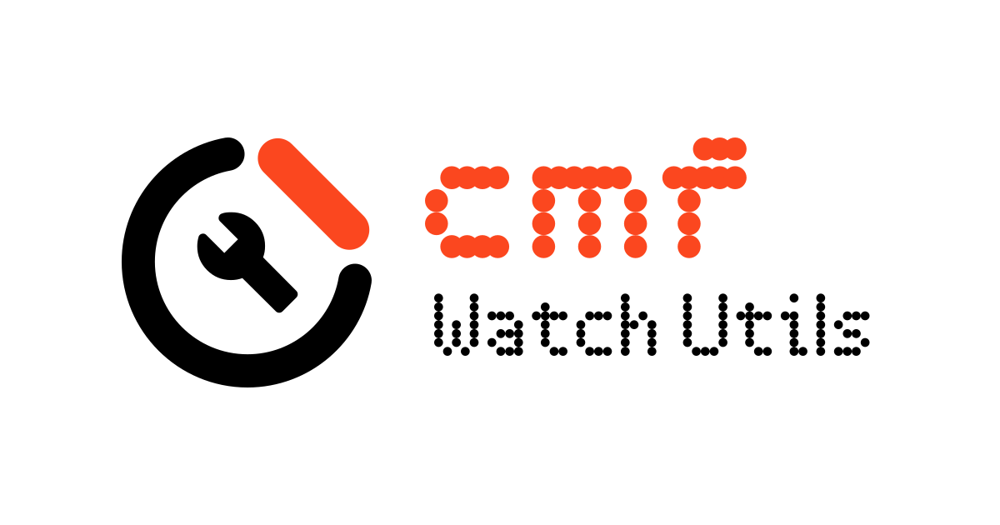

<p align="center">
  <picture>
    <source media="(prefers-color-scheme: dark)" srcset="./og_banner_dark_transparent.svg" />
    <source media="(prefers-color-scheme: light)" srcset="./og_banner_transparent.svg" />
    
  </picture>
</p>

<h1 align="center">CMF Watch Utils</h1>

<p align="center">
  Tooling and documentation for <b>CMF Watch Pro 2</b> — firmware container
  toolkit, BLE tooling, a QEMU emulator preview and reverse-engineering notes.
</p>

<p align="center">
  <a href="https://cmf.arnv.dev/"></a>
  <a href="https://cmf.arnv.dev/devices/cmf-watch-pro-2/"></a>
  <a href="https://github.com/arnav-kr/cmf-watch-utils/actions"></a>
  <a href="https://github.com/arnav-kr/cmf-watch-utils/actions"></a>
  <a href="LICENSE"></a>
  <a href="https://github.com/arnav-kr/cmf-watch-utils"></a>
  <a href="https://github.com/arnav-kr/cmf-watch-utils"></a>
</p>

<p align="center">
  <a href="https://cmf.arnv.dev/"><strong>Read the documentation</strong></a> ·
  <a href="https://cmf.arnv.dev/llms.txt"><code>llms.txt</code></a> ·
  <a href="https://github.com/arnav-kr">Arnav Kumar</a> ·
  <a href="https://arnv.dev">arnv.dev</a>
</p>

---

> [!WARNING]
> Unofficial interoperability project. Not affiliated with or endorsed by Nothing / CMF.
>
> Firmware modification can permanently damage a device — read the
> [limitations](https://cmf.arnv.dev/devices/cmf-watch-pro-2/limitations/) before flashing
> anything.

## What it does

| Area | Result |
|---|---|
| AOTA / SDFS / RES / STY / WFDL / AJS parse and rebuild | verified offline, byte-identical round-trips |
| BLE authentication, shell/AT, watch-face upload | verified on hardware |
| Stock CMF firmware OTA | verified on hardware and over virtual BLE |
| Actions SDK OTA | offline validation and full virtual transfer through image acceptance |
| Watch Pro 2 QEMU | stock, onboarding, Bad Apple and Tilt Mouse booted to the panel on Windows |
| Virtual recovery | stock OTA reset and staged install booted Bad Apple. Modeled crown + charger restored stock after app corruption |
| Custom animation flashed and played | verified on hardware, 202-frame proof of concept |
| Firmware `1.0.0.57` rollback image | published, rebuilt from extracted parts, all CRCs verify |

[Bad Apple firmware](https://github.com/arnav-kr/firmware-wp2-badapple)
(private preview) is a complete example of building a custom Zephyr app for
this watch. The [Bad Apple case study](https://cmf.arnv.dev/devices/cmf-watch-pro-2/guides/bad-apple/)
is public and explains how the player fits the watch's storage and memory.

## Install

Install Git and [uv](https://docs.astral.sh/uv/getting-started/installation/). The workspace
uses Python 3.12 or later. Use the commands for your shell in the
[setup guide](https://cmf.arnv.dev/getting-started/setup/) to clone without large downloads,
then run:

```text
uv sync --locked
uv run cmf-watch-utils emu profiles
```

The [requirements table](https://cmf.arnv.dev/getting-started/requirements/) shows which
optional dependencies each task needs. Git LFS is needed only for fetching the firmware
through Git. The downloads below also have direct links.

## Contents

- [What it does](#what-it-does)
- [Install](#install)
- [Use](#use)
- [Emulator and Actions OTA](#emulator-and-actions-ota)
- [Downloads](#downloads)
- [Layout](#layout)
- [Documentation](#documentation)
- [The three OTA rules that decide the outcome](#the-three-ota-rules-that-decide-the-outcome)
- [Testing](#testing)
- [Attribution](#attribution)
- [License](#license)

## Use

```bash
# offline: parse and verify a firmware image
uv run fwkit info   dumps/binaries/firmware/JX402_V1.0.0.73.bin
uv run fwkit verify dumps/binaries/firmware/JX402_V1.0.0.73.bin
uv run fwkit unpack dumps/binaries/firmware/JX402_V1.0.0.73.bin work/aota

# BLE, read-only first
uv run python tools/cmf_watch.py scan
uv run python tools/cmf_watch.py info
uv run python tools/cmf_watch.py ota-state --duration 5
```

## Emulator and Actions OTA

```bash
uv run cmf-watch-utils emu profiles
uv run cmf-watch-utils emu preflight --image local/update.bin
uv run cmf-watch-utils ota actions --image local/actions-update.bin
```

These commands run offline. The available profiles are `wp2-stock` and `wp2-onboarding`,
both based on Watch Pro 2 stock `1.0.0.73`. Booting needs the project QEMU build, its
compatibility ROM, host runtime libraries and prepared local NOR/NAND fixtures with a NAND ID
sidecar. Use `emu prepare-fixtures` to generate these locally from the stock package and
pinned NAND ID table with an Arm-capable GDB. The interactive viewer also needs Tcl/Tk `wish`. Virtual BLE OTA needs a loopback H4
controller such as Netsim. Ordinary emulator use needs no watch, phone or BLE adapter.

The stock OTA client remains at `tools/ota_client.py`. Actions OTA uses a separate service
and expects a standalone app/SDFS AOTA with an outer `TEMP.bin` and no CMF trailer.
An explicit BLE address enables negotiation on hardware, which can show the update screen.
Physical transfer also requires `--flash`. The `emu ota` command stays on loopback.

The verified recovery flow used QEMU's compatibility ROM and a host model to check the
OTA reset, install staged app/SDFS data and restore a broken virtual app. The physical boot
chain and real crown + charger recovery remain unverified. The Windows runtime was tested.
Linux and macOS are build targets whose runtime integration remains unverified.

- [Emulator setup and commands](https://cmf.arnv.dev/emulator/)
- [Actions OTA reference](https://cmf.arnv.dev/tooling/actions-ota/)
- [Recovery evidence and limits](https://cmf.arnv.dev/devices/cmf-watch-pro-2/internals/recovery/)

## Downloads

For the Watch Pro 2 emulator preview, see the [emulator build guide](emulator/README.md).

The repository stores images with Git LFS. Use Git LFS to fetch them from a checkout or download
individual files below.

| File | Size | SHA-256 (first 16) | Description |
|---|---:|---|---|
| [`JX402_V1.0.0.73.bin`](https://media.githubusercontent.com/media/arnav-kr/cmf-watch-utils/main/dumps/binaries/firmware/JX402_V1.0.0.73.bin) | 56.9 MB | `30903fc8ce6db4f8` | Stock factory firmware, `1.0.0.73` |
| [`JX402_V1.0.0.57.bin`](https://media.githubusercontent.com/media/arnav-kr/cmf-watch-utils/main/dumps/binaries/firmware/JX402_V1.0.0.57.bin) | 56.1 MB | `cd4574f1f9fa3110` | Rollback target, `1.0.0.57` |
| [`JX402_V1.0.0.73_badapple9.bin`](https://media.githubusercontent.com/media/arnav-kr/cmf-watch-utils/main/dumps/binaries/firmware/JX402_V1.0.0.73_badapple9.bin) | 54.1 MB | `4933e593d14bef6f` | Rebuilt image with the animation proof of concept |
| [`app_073.bin`](https://media.githubusercontent.com/media/arnav-kr/cmf-watch-utils/main/dumps/binaries/app/app_073.bin) | 2.4 MB | `30e7978c39d8fb79` | `app.bin` from the `1.0.0.73` image |
| [`app_057.bin`](https://media.githubusercontent.com/media/arnav-kr/cmf-watch-utils/main/dumps/binaries/app/app_057.bin) | 2.4 MB | `26fbe34c10343949` | `app.bin` from the `1.0.0.57` image |

Manifests with full hashes and per-entry CRC status:
[`firmware-1.0.0.73.json`](dumps/manifests/firmware-1.0.0.73.json) ·
[`firmware-1.0.0.57.json`](dumps/manifests/firmware-1.0.0.57.json)

## Layout

```text
tooling/src/fwkit/       format toolkit (AOTA, SDFS, RES, STY, AJS, WFDL, pictures, LZ4)
tooling/tests/           selftest.py, needs a firmware image
tooling/ghidra_scripts/  Ghidra analysis helpers
tooling/redact.py        removes device identifiers from logs before publishing
src/cmf_watch_utils/     packaged BLE, OTA and emulator CLI
src/cmf_watch_utils/emu/ model profiles, QEMU runner, viewer and recovery model
emulator/                QEMU machine, compatibility ROM, NAND reader and build recipe
tests/                   synthetic protocol and emulator checks
tools/cmf_watch.py       existing BLE CLI entry point
tools/ota_client.py      existing stock CMF OTA entry point
tools/spp_ota.py         SPP / RFCOMM experiments
tools/rfcomm.py          RFCOMM helper
tools/maputil.py         address and offset helpers
tools/legacy/            the original standalone unpack, decompress and xref scripts
tools/experiments/       one-off probes that established the pairing and OTA behaviour
site/                    Astro Starlight documentation site
dumps/                   firmware images, analysis output, logs, traces and samples
```

The documentation is organised per device, so new models can be added without duplicating the
tooling:

```text
site/src/content/docs/
  index.mdx               project home and device matrix
  about/                  project-wide documentation
  getting-started/        host setup and first steps
  tooling/                fwkit, BLE, emulator and Actions OTA references
  devices/<model>/        protocol, formats, internals and guides for one device
  ai/                     agent-facing briefings
  dumps/                  manifests and downloadable images
```

## Documentation

```bash
cd site
pnpm install
pnpm dev
```

The site is served from the repository root, so the local preview is at
<http://localhost:4321/>. The published site is <https://cmf.arnv.dev/>.

Key pages:

- [CMF Watch Pro 2](https://cmf.arnv.dev/devices/cmf-watch-pro-2/) — device profile and page map
- [Verified status](https://cmf.arnv.dev/devices/cmf-watch-pro-2/status/)
- [AOTA OTA flow](https://cmf.arnv.dev/devices/cmf-watch-pro-2/protocol/ota/)
- [Flash guide](https://cmf.arnv.dev/devices/cmf-watch-pro-2/guides/ota-flash/)
- [Bad Apple case study](https://cmf.arnv.dev/devices/cmf-watch-pro-2/guides/bad-apple/)
- [Dumps and downloads](https://cmf.arnv.dev/dumps/)
- [Roadmap and devices](https://cmf.arnv.dev/about/roadmap/)
- [Agent context](https://cmf.arnv.dev/ai/context/)

For AI agents: [`/llms.txt`](https://cmf.arnv.dev/llms.txt) lists every page, and
[`/llms-full.txt`](https://cmf.arnv.dev/llms-full.txt) contains the full text.

## The three OTA rules that decide the outcome

These rules describe the stock CMF protocol.

1. INIT2 (`0x9040`) is written to the **OTA characteristic** `...ff01`. Sending it on `CMD_W`
   with a valid session can reboot the watch and drop the link.
2. The watch pulls data; the exact ranges it requests are served. Offsets are not monotonic.
3. On `0xA041`, `0x9041` with payload `A5` is sent. Without that end acknowledgement the
   update stays staged and is never committed.

## Testing

```bash
uv run --locked python -m unittest discover -s tests -v
uv run python tooling/tests/selftest.py dumps/binaries/firmware/JX402_V1.0.0.73.bin
cd site && pnpm build
```

## Star History

<a href="https://www.star-history.com/?repos=arnav-kr%2Fcmf-watch-utils&type=date&legend=top-left">
  <picture>
    <source media="(prefers-color-scheme: dark)" srcset="https://api.star-history.com/chart?repos=arnav-kr/cmf-watch-utils&amp;type=date&amp;theme=dark&amp;legend=top-left" />
    <source media="(prefers-color-scheme: light)" srcset="https://api.star-history.com/chart?repos=arnav-kr/cmf-watch-utils&amp;type=date&amp;legend=top-left" />
    
  </picture>
</a>

## Contributors

<a href="https://github.com/arnav-kr/cmf-watch-utils/graphs/contributors">
  
</a>

See the [full contributor graph](https://github.com/arnav-kr/cmf-watch-utils/graphs/contributors).

## Attribution

- [Arnav Kumar](https://github.com/arnav-kr) — [arnv.dev](https://arnv.dev)
- The watch-face upload behaviour was informed by the AGPL-3.0
  [`freethinkel/fmc`](https://github.com/freethinkel/fmc) project.
- Bad Apple is a copyrighted work; no animation frames are published in the documentation.
  The proof-of-concept image contains them, so the redistribution terms of that work apply to
  that file.

## License

AGPL-3.0. See [`LICENSE`](LICENSE) and
[Legal & attribution](https://cmf.arnv.dev/about/legal/).
